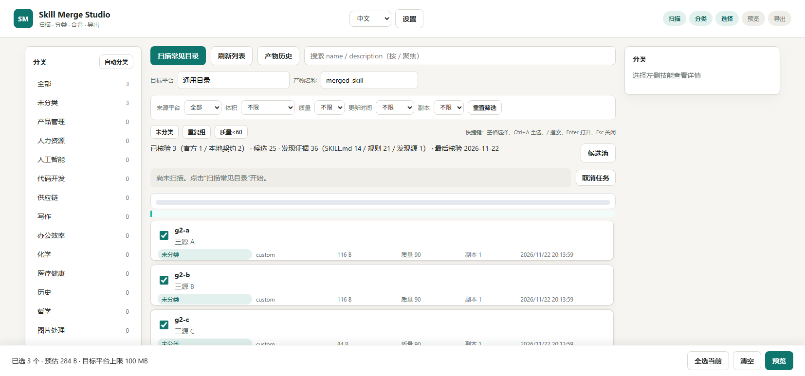
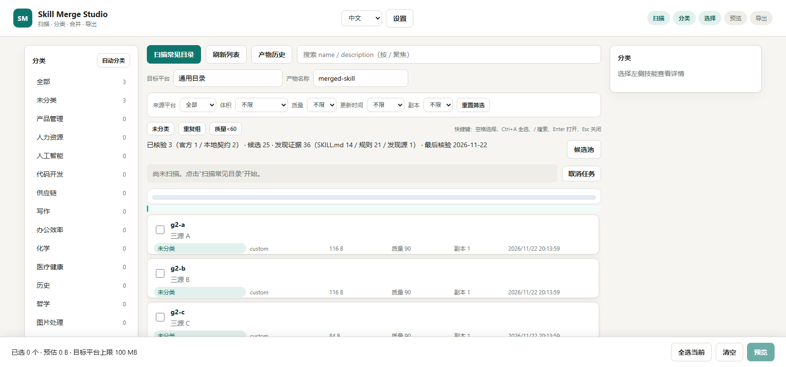
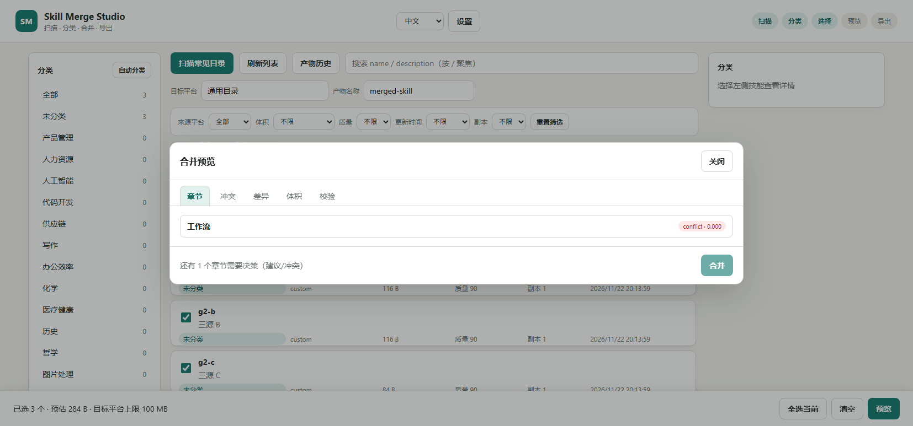
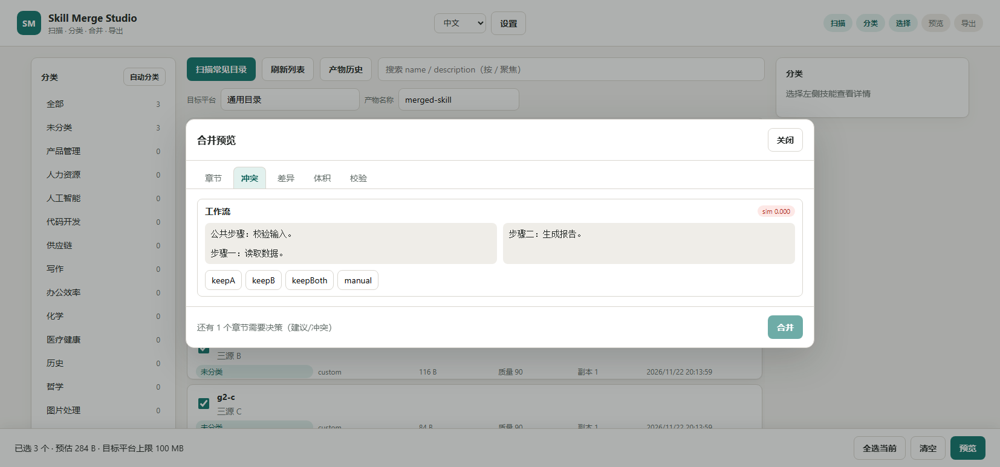

# Skill Merge Studio

把散落在电脑各处的 Agent Skill（`SKILL.md`）扫描出来、建立索引、自动分类，按策略安全合并，
再导出到目标平台或聊天模型，并保留可撤销、可重建的产物历史。

本地优先：服务只监听 `127.0.0.1`；运行时不依赖任何第三方 Python 包（标准库 + SQLite + 原生 ESM 前端）。



## 实测能力

以下结果均在独立数据目录中复跑得到，不是设计稿：

| 能力 | 实测结果 |
| --- | --- |
| 扫描 / 增量重扫 | 3 个演示技能入库；二次扫描复用索引，正文读取 0 次 |
| 预览 | 输出冲突分组、去重、体积估算；章节决策会改变 `plan_hash` 与体积（1268 → 1208 B） |
| 合并 | `keepA` 仅保留 A 版冲突章节并记入 `merge_plan.json`；`keepBoth` 保留全部三源正文 |
| 导出 | zip 导出成功；同一输入两次导出 sha256 一致 |
| 校验 | 18 项检查 ID；候选平台如实给出 warn，不伪造通过 |
| 历史 / 撤销 / 重建 | 撤销把文件移入 `.trash` 并做哈希校验；修改源文件后重建，输出章节级 diff |
| 安全默认 | 无会话令牌访问 API 返回 401；Host / Origin / CSRF 校验；CSP 限制内联脚本 |

自动化测试：`294 passed / 3 failed / 3 skipped / 3 deselected`。
3 个失败均为需求追踪测试里硬编码的旧条数（需求 spec 已从 341 条增至 361 条），不涉及运行功能。

## 快速开始

需要 Python 3.9+，无需安装运行时依赖。

```bash
python server.py
# 或
python -m skillmerge serve
```

Windows 双击 `project/start.bat`；macOS 运行 `project/start.command`；Linux 运行 `project/start.sh`。

默认数据目录为 `project/data/`，可用环境变量改位置：

```bash
SKILLMERGE_DATA_DIR=D:\SkillMergeData python server.py
```

启动后打开终端提示的本地地址（`http://127.0.0.1:<port>/`）。

## CLI

```bash
# 扫描指定目录（可重复 --root）
python -m skillmerge scan --root D:\skills

# 重新分类已入库技能
python -m skillmerge classify

# 合并（--sources 为逗号分隔的技能 id）
python -m skillmerge merge --sources "a,b,c" --name merged-skill --platform generic --strategy keep-all

# 导出产物目录（mode: dir / zip / install / download）
python -m skillmerge export --artifact <产物目录> --platform generic --mode zip

# 按平台规则校验产物目录
python -m skillmerge validate --artifact <产物目录>

# 列出平台治理清单
python -m skillmerge platforms
```

## 界面







## 目录结构

```
project/
  server.py              入口
  skillmerge/
    app.py               装配、路由、生命周期
    http/                HTTP 准入、静态资源、SSE、下载响应
    api/                 scan / classify / preview / merge / export / history
    services/            扫描、分类、合并、导出、历史（撤销 / 重建）、AI 客户端
    platforms/           平台规则
  web/                   原生 ESM 前端
  tests/                 单元 / 集成 / 黄金样例
  demo-skills/           三个演示技能
```

运行时数据（`data/`）、审计日志、备份与构建缓存不入库。

## 已知限制

- `install` 模式只有单元测试覆盖"不覆盖已有文件"，未在真实平台目录实测。
- AI 分类 / 语义复核默认关闭，需要自备 OpenAI 兼容端点；密钥不落盘。
- 平台规则中多数为候选证据等级（启发式），只有 Claude 规则经过官方文档核验。
- 完整流程只在 Windows 上跑过；macOS / Linux 启动脚本未实测。
- 撤销只针对本工具创建、且未被外部修改的文件。

## 安全

- 只监听回环地址；浏览器请求需携带会话令牌，并校验 `Origin`、`Host` 与 `X-Skillmerge: 1` 请求头。
- API 无令牌返回 401；响应带 CSP 与 `frame-ancestors 'none'`。
- 扫描结果和审计记录保存在本地 `data/`，不会上传。
